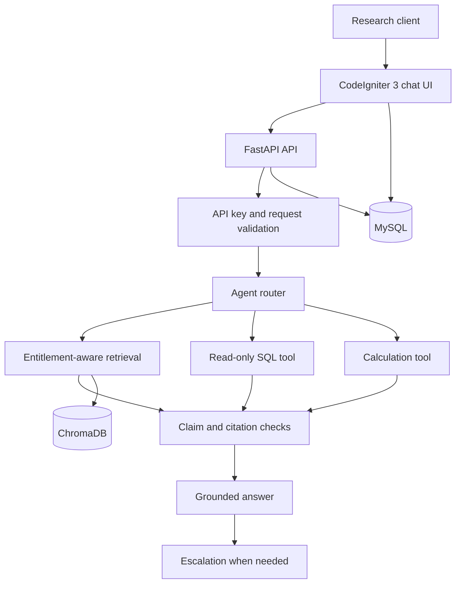

# Project Atlas — AI Report Copilot

An entitlement-aware AI assistant that helps corporate research clients ask questions about purchased market research reports. It uses retrieval-augmented generation (RAG), source citations, verification checks, calculation tools, and human escalation to reduce unsupported answers.

## 1. Project Overview

An analyst can ask factual questions, compare report figures, request calculations, and explore report data. The system checks report access before retrieving report content.

**Main goals**
- Retrieve only reports the selected client is entitled to access.
- Keep conflicting figures separate and explain differences in scope.
- Ground answers in report evidence and provide citations.
- Calculate projections with formulas and explicit assumptions.
- Refuse unsafe or out-of-scope requests.
- Escalate questions when the system cannot provide a reliable answer.

## 2. Technology Stack

- **Backend API:** Python, FastAPI, Pydantic
- **Agent workflow:** LangGraph
- **LLM:** Gemini through the configured model provider
- **Vector store:** ChromaDB
- **Database:** MySQL 8
- **Frontend:** CodeIgniter 3 (PHP)
- **Deployment:** Docker Compose
- **Evaluation:** Python evaluation runner and JSON question set

## 3. Architecture



The diagram shows the intended workflow. Actual behavior should be confirmed against the implementation and evaluation results.

## 4. Repository Structure

```text
api/
  app/
    agent.py
    calculator.py
    chunking.py
    config.py
    critic.py
    db.py
    guards.py
    ingest.py
    llm.py
    main.py
    models.py
    router.py
    sqltool.py
    store.py
  tests/
ci3/
  application/
    controllers/
    libraries/
    models/
    views/
db/
docs/
eval/
  questions.json
  run_eval.py
.github/
  workflows/
```

## 5. Services and API Endpoints

| Method | Endpoint | Purpose |
|---|---|---|
| GET | `/health` | Health check |
| POST | `/ingest` | Ingest the configured synthetic reports |
| POST | `/chat` | Ask a report-grounded question |
| GET | `/escalations` | Retrieve escalation records |

Protected API endpoints require the configured API key in the `X-API-Key` header. `/health` is intended as a health-check endpoint.

Interactive API documentation is available at `/docs` when the API service is running.

### Example chat request

```bash
curl -X POST http://localhost:8000/chat \
  -H "X-API-Key: YOUR_API_KEY" \
  -H "Content-Type: application/json" \
  -d '{"client_id":"C-01","question":"What was the global smart water meter market size in 2024?"}'
```

Replace `YOUR_API_KEY` with your local development key. Never commit real credentials or include them in screenshots or recordings.

## 6. Report Access and Synthetic Data

The assignment uses synthetic market-report data, including smart water meters and residential water purifiers.

- **C-01:** Has access to purchased reports R-101 and R-103.
- **C-02:** Has access to purchased report R-103.
- **R-102:** Represents a public excerpt with a different market scope.

The smart water meter figures in R-101 and R-102 have different scopes. They must not be averaged or presented as directly equivalent. Answers should preserve the source, reporting period, unit, and scope.

A client without access to a purchased report must not receive its protected figures. The application may indicate that a report exists and provide an upgrade option without revealing its contents.

## 7. Security and Reliability

The implementation is designed around these controls:

- Filter report retrieval using client entitlements before sending report content to the LLM.
- Treat instruction-like text inside reports as untrusted data.
- Restrict SQL operations to approved read-only use cases.
- Validate incoming requests and protect API endpoints with an API key.
- Check answer claims against retrieved evidence and preserve valid citations.
- Log relevant events and escalate low-confidence or unsupported answers.
- Escape user-visible content in the CodeIgniter interface and use CSRF protections where configured.
- Keep credentials in environment configuration rather than source code.

These controls should be validated through the automated tests and evaluation workflow before claiming complete security coverage.

## 8. Setup

### Prerequisites

- Git
- Docker and Docker Compose
- A Gemini API key for the configured LLM integration
- Access to the repository

### Local Docker setup

1. Clone the repository and open its root directory.
2. Create a local environment file from the example:

   ```bash
   cp .env.example .env
   ```

   On Windows PowerShell:

   ```powershell
   Copy-Item .env.example .env
   ```

3. Fill in the required values in `.env`. Use strong local passwords and a valid provider API key. Do not commit `.env`.
4. Start the services:

   ```bash
   docker compose up --build -d
   ```

5. Check service status and logs:

   ```bash
   docker compose ps
   docker compose logs --tail=100 api
   ```

6. Ingest the configured reports:

   ```bash
   curl -X POST http://localhost:8000/ingest \
     -H "X-API-Key: YOUR_API_KEY"
   ```

7. Open the API documentation at `http://localhost:8000/docs`. Open the CodeIgniter service using the port published by Docker Compose.

If a service does not start, inspect its logs and confirm that the environment variables and required credentials are configured.

### GitHub Codespaces

Codespaces may require the repository's Codespaces-specific Compose override:

```bash
export COMPOSE_FILE=docker-compose.yml:docker-compose.codespaces.yml
docker compose up --build -d
docker compose ps
```

Use the forwarded port shown in the Codespaces **Ports** panel to open the web interface. The API port may differ from the standard local setup when using the override.

## 9. Evaluation

The evaluation scenarios are maintained in `eval/questions.json`. The evaluation runner is `eval/run_eval.py`.

The scenarios cover behaviors such as:
- Correct answers and citations
- Conflicting source figures
- Client entitlement boundaries
- Prompt-injection attempts
- Calculations and assumptions
- Out-of-scope or unsafe requests
- Human escalation for unsupported questions

After implementation is complete, run the automated tests and evaluation, inspect all failures, and document the actual results. Do not interpret the presence of evaluation questions as proof that the system passes them.

## 10. Documentation

- `docs/DEMO_GUIDE.md` — suggested 3–5 minute demonstration
- `docs/FUTURE_WORK.md` — proposed one-week improvement plan
- `docs/AI_USAGE.md` — AI-assistance disclosure
- `.github/workflows/ci.yml` — configured CI checks

## 11. Known Limitations

- LLM answers and confidence estimates are not guarantees of correctness.
- Numeric and citation checks can miss semantic mismatches or flag valid content.
- Provider quotas, network failures, and model availability can affect responses.
- Synthetic reports do not establish real-world market accuracy.
- Production deployment requires further security review, monitoring, and operational hardening.

## 12. AI-Assistance Disclosure

AI assistance was used during development for coding guidance, debugging, documentation drafting, and test planning. The developer is responsible for reviewing the implementation and validating the reported results. Specific AI tools and models should be named accurately in the final submission.
