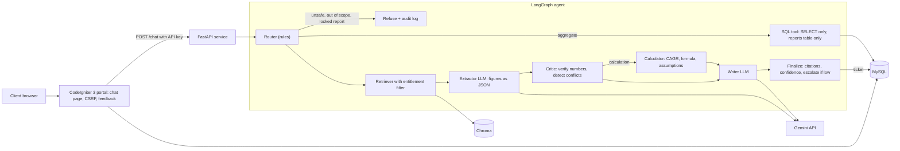

# Project Atlas: Report Copilot

A Report Copilot for a syndicated market-research business. A client asks a question inside the legacy
CodeIgniter 3 portal; a Python agent answers **only from reports that client has purchased**, shows where every
number came from, says when a figure is *derived* or when sources *disagree*, and hands over to a human analyst when
it is not sure.

**Stack:** FastAPI, LangGraph, ChromaDB, MySQL 8, Gemini (LLM + embeddings), PHP 7.4 + CodeIgniter 3.1.13, Docker Compose.

## Architecture



**Request flow.** The CI3 controller posts `{client_id, question}` to `POST /chat` (API key, 40 s timeout, friendly fallback
on failure). The agent routes the question, retrieves only chunks from reports the client may read, extracts figures as
JSON, **verifies each number appears in the cited chunk**, detects conflicts, computes projections with a calculator, and
only then writes the answer from the *verified facts*, not from raw retrieved text. If confidence is below 0.5 (or anything
fails) a ticket is written to MySQL and the client is told an analyst will reply.

## Run it (about 10 minutes)

```bash
git clone <this repo> && cd <repo>
cp .env.example .env          # fill in API_KEY, GEMINI_API_KEY and the three MySQL passwords
docker compose up --build -d
```

* The API **auto-ingests the six reports on first start** (watch: `docker compose logs api | grep auto_ingest`).
  Manual: `curl -X POST localhost:8000/ingest -H "X-API-Key: $API_KEY"`.
* Chat page (CI3): <http://localhost:8080>. API docs: <http://localhost:8000/docs>. Escalations: `GET /escalations`.
* Get a free Gemini key at <https://aistudio.google.com/apikey>.

**GitHub Codespaces note.** Container-to-container bridge networking did not work in Codespaces, so there I ran
`export COMPOSE_FILE=docker-compose.yml:docker-compose.codespaces.yml` (host networking; API on port 8001, chat page on 8080).
The default `docker-compose.yml` is the intended path for a normal Linux/Mac/Windows machine; I could only verify the
Codespaces variant end to end.

**Tests / evaluation**
```bash
cd api && pip install -r requirements.txt pytest && python -m pytest -q tests      # offline: no key, no Docker
ATLAS_URL=http://localhost:8000 python3 eval/run_eval.py                           # 26 live questions -> eval/results.md
```
(`run_eval.py` defaults to port 8001, the Codespaces setup.) Results and failure analysis: `docs/EVALUATION_REPORT.md`.

## How each hard part is handled

| Challenge | What the system does |
|---|---|
| Conflicting sources | Facts from every entitled report are grouped by metric, region and period; differing values or forecast windows become `conflicts[]` with each report's scope. Values are shown side by side, never averaged. |
| Missing numbers | A deterministic calculator derives it (e.g. APAC 2030 = global 2024 x APAC share x (1+CAGR)^n), returns formula, inputs, assumptions and a sensitivity run, and labels it a *derived estimate*. The base-year ambiguity (forecast starts 2025, base is 2024) is stated. |
| Prompt injection | Instruction-like paragraphs are removed at ingestion and logged to `audit_log`; retrieval re-scans; the extractor treats text as data; and the writer never sees raw text, only verified numeric facts. |
| Entitlements | Chroma is queried with `report_id IN (entitled)` before any text reaches an LLM. A question naming a locked report gets a deterministic refusal plus an upgrade path. Locked reports expose title and sector only. The cache key includes the client. |
| SQL safety | Validator (SELECT only, no comments or multiple statements, no sensitive tables, forced `LIMIT 50`), a read-only MySQL user that can read **only** `reports`, and a 5 s execution timeout. "Delete the rows" is stopped by the router and by the validator. |
| Out of scope / sensitive | Politics, other clients' purchases, personal data, prompt-extraction and write requests are refused with a reason and logged. No LLM call is made. |
| Latency and cost | Per-call token cap, in-memory cache (10 min, per client) for real answers, one JSON log line per request with latency, tokens and estimated cost. |

## Design decisions and trade-offs

* **Rule-based router.** Deterministic, free, unit-tested, and unsafe input never reaches an LLM. Trade-off: it is
  phrase-sensitive. Reviewing my own eval set found a real miss ("which clients bought R-101?") that I fixed; an LLM router
  as a second opinion (rules keep veto) is on the one-more-week list.
* **Extract, verify, then write.** Two LLM calls instead of one, but every number in the answer traces to a chunk, and a
  final check flags any number in the draft that no source supports. Trade-off: extra latency and quota.
* **Confidence is a heuristic**: 0.4 retrieval similarity + 0.6 share of claims verified; capped at 0.7 for derived
  estimates; below 0.5 escalates. It is not calibrated on labelled data.
* **Fail toward a human.** If the LLM or vector store fails, the client gets an escalation ticket, never a guess.
  A model-fallback chain handles free-tier quota (20 requests/day/model).
* **No extrapolation.** The calculator only projects inside a report's stated forecast window; "2035" becomes an escalation.
* **Markdown reports.** Six condensed reports with page markers (traps intact), not full-length PDFs.
* **In-memory cache** is lost on restart and not shared between workers; Redis would fix that.
* **CI3 demo client switcher** stands in for the portal login; a real deployment would take `client_id` from the session.

## What I cut (and why)
Hybrid search / re-ranker, semantic cache, multimodal chart ingestion, streaming, Langfuse (structured JSON logs only),
PDF parsing, an overall per-request deadline, and a larger evaluation set. I prioritised correctness and safety of the core
paths over breadth.

## Layout
`api/` FastAPI + LangGraph agent (`app/agent.py`, `router.py`, `critic.py`, `calculator.py`, `sqltool.py`) and tests ·
`ci3/` CodeIgniter 3 app (controller, library, model, view) · `db/` schema, seed, users · `data/reports/` the six reports ·
`eval/` 26-question harness · `docs/` evaluation report, one-page note.

## AI-assistant disclosure
I used **Claude (Anthropic)** as a coding assistant throughout: it generated the first versions of the API, the LangGraph
agent and its tools, the CodeIgniter 3 app, the Docker files, the evaluation harness, the six synthetic reports and this
documentation. I ran everything, debugged the environment (Docker/WSL, Codespaces networking, Gemini model availability
and quota), reviewed the code, and fixed issues found along the way. I can explain each module.
